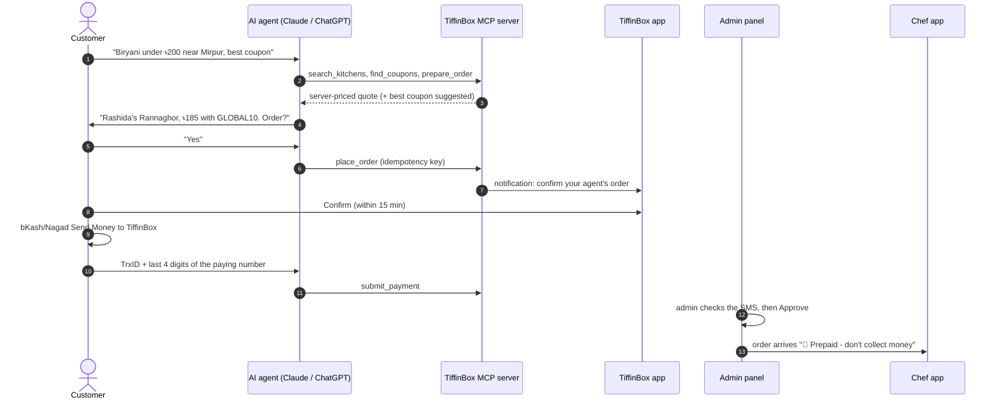
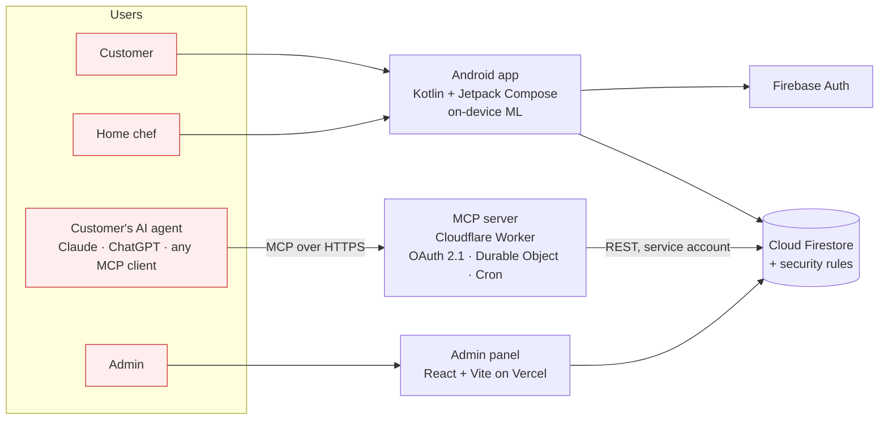

<div align="center">

# 🍱 TiffinBox

### *ঘরের খাবার, এক tap দূরে — now orderable by your own AI agent*

**An AI-native hyperlocal marketplace that connects home chefs with students and
working people who miss home-cooked food.**

[](app/)
[](admin-web/)
[](mcp-server/)
[-FFCA28?logo=firebase&logoColor=black)](https://firebase.google.com)
[-F38020?logo=cloudflare&logoColor=white)](mcp-server/)
[](#-testing--quality)
[](LICENSE)
[](https://cloudcampbd.com/ai-builders-congress)

**[⬇️ Download the APK](https://github.com/ratul-hossen/tiffinbox/releases/latest)** ·
**[🛠️ Admin panel](https://tiffinbox-admin.vercel.app)** ·
**[🤖 MCP server](https://tiffinbox-mcp.mytiffinbox.workers.dev)**

</div>

---

## 📖 Contents

1. [The problem](#-the-problem)
2. [Our solution](#-our-solution)
3. [What makes it different](#-what-makes-it-different)
4. [AI in TiffinBox](#-ai-in-tiffinbox)
5. [Order food with your own AI agent (MCP)](#-order-food-with-your-own-ai-agent-mcp)
6. [Features](#-features)
7. [Architecture](#-architecture)
8. [Tech stack](#-tech-stack)
9. [Trust, safety and security](#-trust-safety-and-security)
10. [Testing and quality](#-testing--quality)
11. [Try it / run it](#-try-it--run-it)
12. [Repository structure](#-repository-structure)
13. [Business model and impact](#-business-model--impact)
14. [Roadmap](#-roadmap)
15. [Event and team](#-event--team)
16. [License](#-license)

---

## 🎯 The problem

Thousands of university students, mess residents and working people in
Bangladesh eat oily, unhygienic or expensive outside food every day. At the
same time, thousands of homemakers cook every day and would happily sell a few
extra plates, but they have **no structured way to reach nearby customers**.

- Facebook groups and WhatsApp have no discovery, no verification, no live
  availability and no safe payment.
- Foodpanda and Pathao Food are built for **restaurants**, not **home
  kitchens**.
- People increasingly use AI assistants for everyday tasks, but no local food
  platform lets an assistant act for them safely.

> **বাসার বাইরে প্রতিদিন খাওয়া মানেই তেল-মশলা, hygiene-এর সমস্যা আর একঘেয়ে মেনু।**

## 💡 Our solution

**TiffinBox** has three parts that work together:

| Part | For whom | What it does |
|---|---|---|
| 📱 **Android app** | Customers and home chefs | Discover verified home kitchens nearby, order or subscribe to meal plans, chat, track orders, earn points. Chefs run their kitchen: menu, plates left, orders, earnings, coupons. |
| 🛠️ **Admin panel** (web) | TiffinBox team | Approve and verify chefs, manage orders, coupons, delivery, payments, refunds, revenue, and the AI-agent controls. |
| 🤖 **MCP server** | Customers' own AI agents | Lets Claude, ChatGPT or any MCP client search kitchens, find coupons and place orders **for the customer**, with the customer's confirmation and payment always in the loop. |

## 🆚 What makes it different

| | Facebook groups | Foodpanda / Pathao | **TiffinBox** |
|---|---|---|---|
| Home kitchens as real businesses | ⚠️ informal | ❌ restaurants only | ✅ verified chefs, menus, earnings |
| Verification | ❌ | ✅ restaurants | ✅ admin approval + NID & kitchen check badge |
| Live "plates left" | ❌ | ✅ | ✅ reserved atomically, never oversold |
| Meal plans for students | ❌ | ⚠️ rare | ✅ 7/10/15/30-day plans |
| Personal AI recommendations | ❌ | ⚠️ | ✅ on-device ML, no data leaves the phone |
| **Order through your own AI agent** | ❌ | ❌ | ✅ **MCP server, human-confirmed** |
| Bengali-first | ✅ | ⚠️ | ✅ full Bengali + English |

> **TiffinBox treats home kitchens as first-class businesses, and lets your
> own AI agent order from them for you, without ever taking the decision away
> from you.**

---

## 🧠 AI in TiffinBox

| # | AI feature | How it works | Where |
|---|---|---|---|
| 1 | **Agentic ordering (MCP)** | The customer's own AI agent uses 19 TiffinBox tools: search, menus, coupons, quote, order, payment, chat. All prices are computed by our server, and the customer confirms every order in the app. | [`mcp-server/`](mcp-server/) |
| 2 | **Recommendation engine** | A logistic-regression model trained on a real food-delivery dataset (Swiggy listings; F1 0.668), plus a kitchen-quality score (Bayesian-smoothed ratings, on-time stars, distance, repeat orders, offers). It runs **on the phone** as plain Kotlin maths: no server, no API cost. | [`ml/`](ml/), `app/.../domain/` |
| 3 | **Natural-language search** | TF-IDF + logistic regression detects intent ("cheap veg dinner") and re-ranks results, without hiding exact matches. | `app/.../domain/ml/` |
| 4 | **Demand forecasting for chefs** | Forecasts upcoming demand from the chef's own order history, so they cook the right amount. | `DemandForecastEngine.kt` |

The training data, models and honest F1 scores are documented in
[`ml/MODEL_REPORT.md`](ml/MODEL_REPORT.md).

---

## 🤖 Order food with your own AI agent (MCP)

TiffinBox runs a **Model Context Protocol (MCP) server**, so a customer can
connect the AI agent they already use and simply say:

> *"মিরপুরে ২০০ টাকার মধ্যে বিরিয়ানি খুঁজে দাও, সবচেয়ে ভালো coupon দিয়ে।"*



**Connecting takes one minute and no password.** In the app go to Profile →
**এআই এজেন্ট (MCP)**, add the server address to your agent, then type the
8-letter code the app shows. The agent's consent page shows **where your
data goes**, and warns about unverified agents. Disconnect any time.

**Tools (19):** `search_kitchens`, `get_menu`, `get_meal`,
`get_delivery_quote`, `find_coupons`, `list_areas`, `list_my_addresses`,
`get_my_profile`, `get_my_rewards`, `list_my_orders`, `get_order_status`,
`list_my_notifications`, `list_my_chats`, `read_chat`,
`send_message_to_kitchen`, `prepare_order`, `place_order`, `submit_payment`,
`cancel_order`.

**Human in control, always:**
- the customer confirms every order in the app;
- payment is the customer's own Send Money (no cash on delivery for agent
  orders);
- an admin verifies every payment before the kitchen sees the order;
- refunds are tracked end to end.

The full payment contract is in
[`docs/AGENT_PAYMENTS.md`](docs/AGENT_PAYMENTS.md).

---

## 🌟 Features

### 👤 Customers
- Nearby home kitchens with real distances, delivery fee and ETA. There is
  an OpenStreetMap map view, so no Maps API is needed.
- Menus with photos, "plates left" and Today's Special.
- Dietary info, allergens, and veg/non-veg flags.
- Cart and checkout with bKash/Nagad (TrxID proof) or cash on delivery.
- Coupons, **TiffinBox Points** and five reward ranks. The top rank gets free
  delivery.
- Meal-plan subscriptions (7/10/15/30 days), aimed at students.
- Live order tracking, a 5-minute self-cancel, and reviews with photos on
  four dimensions: taste, hygiene, packaging, on-time.
- WhatsApp-style chat with kitchens, in-app notifications and favourites.
- Five colour themes with dark mode, fully in Bengali and English.

### 👩‍🍳 Home chefs
- A three-step signup with mandatory location, then admin approval.
- A verified badge after NID and kitchen-photo checks.
- Menu manager with photos, availability switches, Today's Special and
  plates per day.
- Orders flow from Accepted to Cooking, Out for delivery and Delivered.
  Agent orders show a prepaid badge.
- Earnings charts and a demand forecast.
- Their own coupons, their own delivery charge (capped by the admin), video
  posts, and an application for TiffinBox delivery.

### 🛠️ Admins (web)
- Dashboard and revenue analytics.
- Chef approvals and verification.
- Orders, coupons, area-based delivery surcharges and delivery applications.
- **Agent Payments**:
  - check the amount and the sender's last 4 digits, then Approve, Ask again
    or Reject;
  - **Refunds due** tab;
  - an alert when a payment has waited over 30 minutes.
- AI-agent controls: an on/off kill switch, a daily quota budget, and
  per-user disconnect or block.
- Recycle Bin, activity log, multiple admins with a super-admin tier, and
  demo-data seeding.

---

## 🏗️ Architecture



**Designed for the free tiers on purpose.** There is no Cloud Functions, no
Firebase Storage and no Maps billing:
- Photos are compressed on the phone and stored in Firestore.
- Locations use on-device GPS, the Geocoder and haversine maths.
- Order expiry runs on a Cloudflare Cron Trigger.
- The ML models ship inside the app.

What runs costs **৳0/month** today.

## 🧰 Tech stack

| Layer | Technology |
|---|---|
| Android | Kotlin, Jetpack Compose (Material 3, BOM 2026.08), AGP 9.1, min SDK 24, MVVM + repositories, Navigation Compose, Lottie, Vico charts, osmdroid (OpenStreetMap) |
| Backend data | Firebase Authentication (email + Google), Cloud Firestore with security rules, FCM |
| Admin | React 18, TypeScript, Vite, Tailwind CSS, deployed on Vercel |
| AI agents | Cloudflare Workers, `@modelcontextprotocol/sdk` (Streamable HTTP), `@cloudflare/workers-oauth-provider` (OAuth 2.1 + PKCE), Durable Objects, KV, rate-limit bindings, Cron Triggers |
| ML | scikit-learn for training (Python), exported weights run in plain Kotlin |
| Quality | JUnit, Vitest, Firestore emulator rules tests, end-to-end MCP tests, GitHub Actions CI and signed release builds |

---

## 🛡️ Trust, safety and security

**Chefs:**
- Admin approval before a kitchen is listed.
- NID and kitchen-photo verification badge.
- Chefs can't approve themselves, raise their own delivery cap, or touch an
  unpaid agent order. Firestore rules enforce all three.

**Money:**
- Server-side pricing for agent orders.
- Plates reserved atomically.
- Each TrxID can be used once.
- Manual admin verification of every payment.
- A refund trail for every paid order that is cancelled.

**AI agents:**
- One-time pairing code (single use, 5-minute life, lockout after wrong
  guesses).
- The consent page shows the redirect host; unknown hosts are labelled
  "Unverified agent".
- Scoped tokens.
- At most 3 agents per customer.
- Instant disconnect, plus an admin block and a kill switch.

**Abuse limits:**
- Per-IP limits (IPv6 /64-aware), per-agent and per-customer limits.
- Daily order limits by trust level.
- Message limits.
- A Firestore read budget, so agent traffic can never take the app down.

**Privacy:**
- Field masks keep chefs' phone, bKash/Nagad numbers, NID and addresses
  away from agents.
- Kitchen-written text is treated as data, never as instructions (prompt
  injection).

Details: [`mcp-server/README.md`](mcp-server/README.md) and
[`docs/AGENT_PAYMENTS.md`](docs/AGENT_PAYMENTS.md).

## ✅ Testing & quality

| Suite | What it proves | Result |
|---|---|---|
| Firestore rules, on the real emulator | Every legitimate write is allowed and every tampered one is refused (orders, payments, refunds, chats, coupons, MCP pairing) | **98 / 98** |
| MCP server unit tests | Delivery-fee, coupon and rewards maths match the Android app exactly; plus security helpers | **64 / 64** |
| MCP end-to-end, against the emulator | The real OAuth flow, all 19 tools, payments, idempotency, limits, expiry sweep, disconnect | **104 / 104** |
| Android | Build, unit tests and release lint | ✅ |
| CI | Every pull request builds the app and tests the MCP server; every tag builds a signed APK release | ✅ |

---

## 🚀 Try it / run it

### Just try it
1. Install the APK from **[Releases](https://github.com/ratul-hossen/tiffinbox/releases/latest)**
   (Android 7.0+).
2. Sign up as a customer, set a Dhaka address, and browse kitchens. Demo
   kitchens are marked **DEMO**.
3. Optional: in the app go to Profile → **এআই এজেন্ট (MCP)**, copy the server
   address into Claude (Settings → Connectors → Add custom connector), and
   connect with the code.

### Build from source
**Android app:**
- Open the repo in Android Studio. It needs JDK 21 and the Android SDK.
- Add your own `app/google-services.json` from a Firebase project.
- Run the `app` configuration.

```bash
./gradlew :app:assembleDebug :app:testDebugUnitTest
```

**Admin panel:**

```bash
cd admin-web && npm ci && npm run dev
```

**MCP server** (Cloudflare Workers; deploy steps are in
[`mcp-server/README.md`](mcp-server/README.md)):

```bash
cd mcp-server && npm ci && npm test && npx wrangler dev
```

**Firestore rules tests** (need Java 11+):

```bash
cd firestore-tests && npm install --legacy-peer-deps && npm test
```

Release process: [`docs/RELEASING.md`](docs/RELEASING.md). Changes:
[`CHANGELOG.md`](CHANGELOG.md).

## 📁 Repository structure

```
tiffinbox/
├── app/                 Android app (customer + chef), Kotlin + Compose
│   └── src/main/java/com/ratulhossen/tiffinbox/
│       ├── data/        Firestore repositories, caches, pricing context
│       ├── domain/      delivery fees, rewards, recommendation, forecasting, ML
│       └── ui/          43 screens, components, themes, navigation
├── admin-web/           Admin panel (React + TS + Tailwind)
├── mcp-server/          MCP server for AI agents (Cloudflare Worker, TS)
├── firestore.rules      Security rules (source of truth)
├── firestore-tests/     Emulator tests for the rules
├── ml/                  Model training scripts, dataset source, model report
├── docs/                Payments contract, releasing, UI/UX review
└── .github/workflows/   CI and signed release builds
```

---

## 💰 Business model & impact

**Revenue:**
- 10–15% commission per order, plus a small platform fee per order.
- A fee on meal-plan subscriptions.
- Featured listings for top-rated verified chefs.
- Optional TiffinBox delivery service (already in the app as a chef
  subscription).
- Corporate and campus meal partnerships.

**Social impact:**
- 👩‍🍳 Income for homemakers from their own kitchens.
- 🥗 Healthier, cheaper food for students.
- ♻️ Less food waste through demand forecasting and plates-left limits.
- 🏘️ Neighbourhood trust.
- 🤖 AI that helps without taking control away from people.

## 🗺️ Roadmap

- **Now (hackathon):** everything above, live on free tiers.
- **Next:**
  - a bKash/Nagad merchant API, for instant payment confirmation;
  - push notifications from the Worker;
  - an in-app Bengali assistant that uses the same MCP tools;
  - a delivery-partner app.
- **Scale:**
  - a server-side checkout for app orders too;
  - indexed queries and aggregates;
  - a chef payout ledger;
  - expanding from campus to neighbourhood to the whole city.

---

## 🏆 Event & team

Built for the **International AI Builders Congress 2026**, organised by
CloudCamp Bangladesh at Daffodil International University, Dhaka (Commerce
domain).

| Member | Role |
|---|---|
| **Md Ratul Hossen** | Team lead |
| *Add teammates here* | |

## 📄 License

**Copyright © 2026 Md Ratul Hossen and the TiffinBox team.**

TiffinBox is licensed under the **GNU Affero General Public License v3.0**
([LICENSE](LICENSE)). You may use, study and modify it, but if you
distribute it, or run a modified version as a network service (like the
admin panel or the MCP server), you must release your complete source code
under the same license. The **TiffinBox name and logo are not licensed** for
use by forks (see [NOTICE](NOTICE)). Fonts and libraries keep their own
licenses ([`licenses/`](licenses)).

<div align="center">

### 🍱 Built with ❤️ for everyone who misses ঘরের খাবার

*Made in Bangladesh 🇧🇩*

</div>
